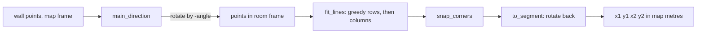

# wall_fit: from scattered wall cells to a floor plan's straight lines

A SLAM occupancy grid draws walls as ragged, speckled bands of cells. A floor plan draws them as a few **straight lines meeting at corners**. `wall_fit` turns one into the other.

It knows nothing about ROS or grids. Its input is an **N × 2 array of wall points in metres**, and its output is a list of lines. `floor_plan` does the grid work and calls into this module.

## The idea: most rooms are rectilinear

Indoor walls nearly always run along **two perpendicular directions**. If we find those directions, the problem gets much easier: rotate the points so the room's walls run along x and y, and then a wall is just a **dense row or column of points**.

The pipeline has three steps:



## Finding the room's direction

`main_direction` tries every rotation from 0° to 89° in 1° steps. For each one it bins the rotated points by x and by y, and scores the **sum of squared bin counts**.

```python
for axis in (0, 1):
    bins = np.floor(turned[:, axis] / resolution_m).astype(int)
    counts = np.bincount(bins - bins.min()).astype(float)
    score += float((counts**2).sum())
```

The sum of squares is a classic **concentration measure**. The same N points spread evenly over many bins score low; piled into a few bins they score high. At the right angle, every wall collapses into one or two bins, so the score peaks.

- **Only 0–90° is searched.** Rotating a rectilinear room by 90° gives the same picture, so the other three quarters add nothing.
- **Cost** is 90 × N binning operations: a few milliseconds even on the Pi.

## Greedy line extraction

In the room frame, `take_lines` repeatedly takes the **densest row** of the points not yet used:

1. Histogram the free points' coordinate (y for horizontal lines) at grid resolution and pick the fullest bin.
2. Refine the line's level to the **median** of the points near that bin, which is robust to a few stray cells.
3. Collect every point within `LINE_BAND_M` (12 cm) of the level: the *band*.
4. Split the band along the line into **runs** at gaps over `MAX_GAP_M` (30 cm), so doorways stay open.
5. Keep runs that are long enough (≥ 30 cm and ≥ 6 points) as lines, and mark their points used.

```python
for start, end, members in runs_along(points[band, along]):
    if end - start >= MIN_SEGMENT_M and len(members) >= MIN_LINE_POINTS:
        lines.append(Line(axis, level, start, end))
        used[band[members]] = True
```

One subtlety sits in the `tried` mask. A band whose runs are all too short is skipped for the rest of *this* pass, but its points are not marked used. The **vertical pass can still claim them**: a short stub of horizontal points may be the end of a vertical wall. Points that no line claims become **clutter**, which the page draws as loose dots (furniture, people, noise).

`fit_lines` runs horizontal lines first, then vertical. The order matters only for points at corners, which the first pass takes.

## Closing corners

Fitted lines usually stop a cell or two short of each other, because the corner cells were claimed by just one of the two walls. `snap_corners` checks every horizontal–vertical pair. When each one reaches within `CORNER_SNAP_M` of the other's level, both ends move onto the crossing point:

```python
if upright.spans(across.level, CORNER_SNAP_M) and across.spans(
    upright.level, CORNER_SNAP_M
):
    across.snap_end(upright.level)
    upright.snap_end(across.level)
```

The same rule also trims a line that **overshoots** a corner slightly, since `snap_end` moves whichever end is within reach.

## The `Line` representation

A line lives in the room frame as `Line(axis, level, start, end)`:

- `axis` is the coordinate held **constant** (`HORIZONTAL = 1` holds y).
- `level` is that constant's value.
- `start`, `end` run along the other axis.

Four numbers with a shared frame make matching, snapping and comparing lines trivial. `to_segment` is the only place that rotates back to map metres and rounds to millimetres for the page.

## Observations

- **Non-rectilinear rooms** (a 45° bay wall) have their walls broken into staircase fragments or left as clutter. A second pass at the residual points' own direction could recover them.
- **The 1° angle step** limits accuracy to about ±0.5°. Over a 10 m wall that is ~9 cm at the far end; a parabolic refinement around the best angle would be cheap.
- **`take_lines` has no iteration cap.** It ends because every pass marks at least one band as tried, but the argument is subtle enough to deserve a sentence in its docstring.
- `MIN_LINE_POINTS` is used both as "enough points to try" and "enough points per run". Separate names would make tuning clearer.
