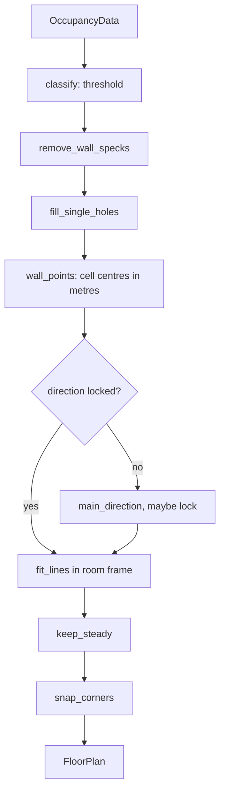

# floor_plan: cleaning `/map` into something people can read

slam_toolbox publishes `/map` as an `OccupancyGrid`: a row-major array of percentages, -1 for unknown. Drawn as-is, it is grey noise with black speckles. `floor_plan` turns it into what the page draws:

- a **floor grid** of just two classes, free and unknown,
- **straight wall segments** in `map` metres,
- **clutter** points: wall cells no segment explains.

It is pure numpy. The ROS message becomes a plain `OccupancyData` dataclass at the bridge, so this module can be tested from synthetic grids and saved `.pgm` maps.

## One update, step by step



### Thresholds

`classify` maps percentages to three classes: below 25 is **free**, above 65 is **wall**, everything else (including -1) is **unknown**. The middle band stays unknown on purpose; a half-certain cell drawn as wall is worse than one left blank.

It also **checks the cell count** against width × height and raises if they disagree. That is the one validation at this boundary, and everything after trusts the shape.

### Specks and holes

- **Specks**: `remove_wall_specks` flood-fills each 8-connected blob of wall cells (a breadth-first search in `wall_blob`) and turns blobs under 4 cells into free. A lidar reflection off a chair leg is a speck; a wall never is.
- **Holes**: `fill_single_holes` makes an unknown cell free when at least three of its four neighbours are free. It is vectorised with a padded array and four shifted views, the standard numpy idiom for neighbour counts.

The BFS is plain Python. On real maps this is fine, because only wall cells are visited and they are a small fraction of the grid.

## Keeping walls steady

SLAM republishes the map every few seconds, and each version differs slightly. Refitting from scratch every time would make the walls **flicker**. A `FloorPlanner` lives for one run and remembers its last fit.

### The direction locks, but only once it can be trusted

The room's direction is **re-estimated on every map until there is enough wall**: 200 wall cells, or 3 m of fitted lines. Then it is held for the rest of the run.

```python
if not self.is_direction_locked and len(points) >= MIN_LINE_POINTS:
    angle_rad = main_direction(points, resolution)
    if angle_rad != self.angle_rad:
        self.lines = []
    self.angle_rad = angle_rad
```

This replaced an earlier rule that locked on the very first map with 6 wall cells. A short wall seen early in a run could then fix a 27° tilt for every wall drawn afterwards. When the direction changes before locking, the old lines are **dropped**: they were fitted in a different rotated frame and can't be compared with new ones.

### Unchanged walls keep their ends

`keep_steady` pairs each new line with a previous one that **matches**: same axis, level within the 12 cm band, overlapping span. The previous line is kept unless the map **changed under it**.

"Changed" is computed as a set difference. Each update records the wall cells as integer keys in the `map` frame (`cell_keys`), and the symmetric difference with the previous update's keys is the set of cells that appeared or vanished:

```python
changed = np.array(sorted(self.wall_keys ^ keys), dtype=float).reshape(-1, 2)
```

Keys are computed from metres, not grid indices, so they stay comparable when the map **grows** and its origin moves. `is_disturbed` then asks whether any changed cell lies in the old line's footprint: its band, plus a doorway's width beyond each end.

## What the page gets

```python
FloorPlan(
    floor=np.where(grid == UNKNOWN, UNKNOWN, FREE).astype(np.uint8),
    walls=[to_segment(line, self.angle_rad) for line in lines],
    wall_cells_xy_m=points[used],
    clutter_xy_m=points[~used],
    ...
    angle_rad=0.0 if self.angle_rad is None else self.angle_rad,
)
```

`used` splits the occupied cells in two: the **wall cells** under some fitted line, and the **clutter** no line explains. Together they are every occupied cell, none twice, which `test_wall_cells_and_clutter_cover_every_occupied_cell` checks against the real `f36run6` map. The page draws both as grey squares, so a viewer sees the raw evidence under each fitted wall.

`angle_rad` hands the room's direction to the page, which turns the view by it to square the walls up (F02). It is 0.0 until the planner has a direction, so the page always has a number.

Wall cells are reported as **free** in `floor`. The page draws walls as segments on top, so the floor under a wall should look like room, not like a hole.

## Observations

- **On a very sparse map** (like `f36run6`, 105 wall cells, 67 of them specks) the direction may never lock, and walls can shift slightly between updates. A lock after N stable estimates in a row would bound that.
- **The changed-cell test** treats any change in a line's footprint as a reason to refit it, including a single new speck that is then removed. Comparing after speck removal (as now) helps; a small count threshold would help more.
- **The map origin is assumed to have zero yaw**, as slam_toolbox publishes it. A check at `classify` would turn a silent misdraw into an error if that ever changes.
- `update` is about 30 lines and does five things; splitting out a `fit(points, resolution)` helper would make the steady-wall logic easier to read in isolation.
