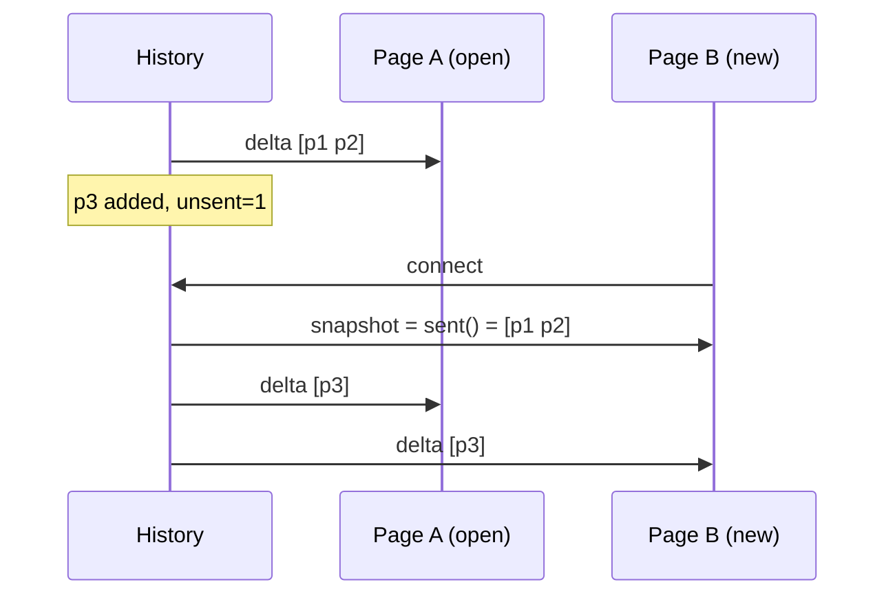

# run_history: the trail and the graphs, sent in pieces

Two things on the page grow for a whole run: the robot's **trail** and four small **graphs** (battery, power, speed, objects found). Resending them in full ten times a second would be wasteful, so they go out as **deltas**. This module holds them and decides what each send contains.

## History: a capped, thinned list that knows what's been sent

Both the trail and the graphs are built on one small class:

```python
class History:
    def __init__(self, max_points: int, min_step: float, step: Callable):
        self.points: deque = deque(maxlen=max_points)
        ...
        self.unsent_count = 0
```

- **Capped**: a `deque(maxlen=...)` drops the oldest point automatically.
- **Thinned**: `add` skips a point closer than `min_step` to the last one. *Closer* is defined by the `step` function: distance in metres for the trail, seconds for the graphs.
- **Unsent count**: the number of newest points not yet broadcast.

The unsent count is the trick that lets the server work with **no per-page state**:

- `take_unsent()` returns the newest points for a broadcast and resets the count.
- `sent()` returns everything *except* the unsent tail. That is exactly what every open page already has.

So a page that opens mid-run gets `sent()` as its snapshot, and then the same next delta as everyone else. **No point arrives twice, and none is missed.**



## The trail lives in `odom`, not `map`

slam_toolbox corrects the robot's position by adjusting the `map → odom` transform, sometimes by tens of centimetres at a **loop closure**. A trail stored in `map` would keep its old shape and end up cutting through walls.

So `Trail` stores points in **`odom`**, which never jumps, and converts them through the current `map → odom` (`compose`) each time it sends. When that transform has moved by more than 5 cm or 0.02 rad since the last full send, the whole trail is resent:

```python
if sent is None or has_shifted(sent, map_from_odom):
    self.history.take_unsent()
    self.sent_map_from_odom = map_from_odom
    return self.message(list(self.history.points), is_full=True)
```

Smaller corrections are ignored. They accumulate against the last *full* send, not the last update, so drift eventually triggers a resend too.

## Pose2D and compose

`Pose2D(x_m, y_m, yaw_rad)` is a 2-D rigid transform. `compose(parent, child)` applies the standard **SE(2) composition**: rotate the child by the parent's yaw, then translate. It is used for the trail, the robot pose and the laser hits, so it lives here at the bottom of the dependency chain.

## RunSeries: four graphs, one clock

`RunSeries` holds one `History` per graph, keyed by name, with points as `[seconds since run start, value]`. Times are relative to the run start, so the page doesn't need to know the robot's clock. That matters under **bag replay**, where the clock is simulated.

`add` takes any subset of series at once, for example battery percent and power from one battery message, and returns one delta with only the series that gained a point.

## Observations

- **The snapshot transform**: `Trail.snapshot` converts through the last *sent* transform, which can be up to 5 cm stale. That matches what other pages show, which is the point, but deserves a comment.
- **A cap overflow between sends** clamps `unsent_count` to the deque's length. A trail cap of 2000 points at 5 cm spacing is 100 m of driving, so this is unlikely, but it would be the first place to look if a trail ever came out short.
- **The page must cap too**: `max_points` is in every message so the page drops its oldest points in step with the server. The rule lives in two places, and TF01.7 must remember it.
