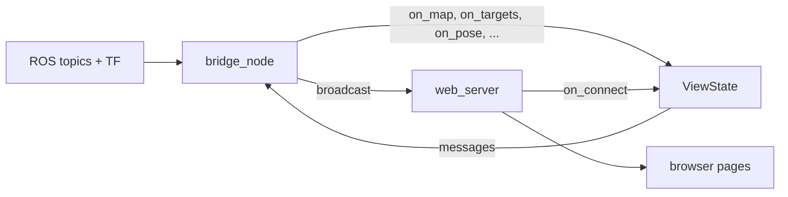

# view_state: everything the page shows, as JSON messages

`view_state` is the **heart of the viewer**. It takes robot data in, keeps the page's state, and returns small JSON messages. It is pure: no `rclpy`, no sockets, and the current time is always passed in, so tests control the clock.

## Where it sits



The bridge calls three kinds of method:

- **`on_*`**, one per incoming message (`on_map`, `on_targets`, `on_pose`, `on_scan`, `on_battery`, `on_speed`, `on_camera`). Each returns the messages to broadcast.
- **`tick(now_s)`**, about once a second: status, plus the targets again, because a target's "lost" flag and "seen 2 min ago" change with time alone.
- **`snapshot(now_s)`**, for a page that has just connected.

`ViewState` is **not thread-safe**. The web server calls `snapshot` from its own thread, so the bridge must hold one lock around every call.

## Run start: a quiet gap

The run ticker, the trail and the graphs all belong to a **run**. Detecting when a new one starts was the open design question. The answer chosen is a *quiet gap*:

```python
last_s = max(self.heard_s.values(), default=None)
self.heard_s[source] = now_s
if last_s is not None and now_s - last_s <= RUN_GAP_S:
    return []
self.planner, self.trail, self.run = FloorPlanner(), Trail(), RunSeries(now_s)
return [self.trail.snapshot(), self.run.snapshot()]
```

The first robot message ever, or the first after **every** source has been silent for over 30 s, starts a run. It returns empty full messages so every page clears its trail and graphs.

Why this rule:

- It needs **no cooperation** from other packages: no "run started" topic, no slam_toolbox internals.
- A robot that reboots or a bag that is restarted after a pause both produce a gap.
- It is a few lines of pure logic, tested at 29 s and 31 s.

## Targets: names and "lost"

The `SemanticTarget` message carries a class label and an ID but no display name and no lost flag. `view_state` adds both.

- **Names** come from `dome_semantic`'s class profiles: "soda can · CN1". `name_and_id` copies `dome_semantic`'s `short_label` rule (abbrev plus ID, or the first two letters upper-cased), because the original lives in a module that imports `rclpy`.
- **The profiles must be keyed by the detector label**, and getting this wrong made the whole mechanism a no-op for a day. `load_class_profiles` keys by `canonical_class` — `"soda can"` — while `/semantic/targets` publishes the *detector* label — `"can"`. So `profiles.get(label)` missed every time and every target fell back to its raw label, with nothing to show that anything was wrong. The bridge now joins the two through each profile's `detector_labels`, exactly as `dome_semantic`'s own `build_label_map` does. The lesson is that a lookup whose miss is a *legitimate* fallback cannot report its own failure; only real data showed it.
- **The raw `label` goes out as well as the display name** (added TF01.8). The page chooses each object's icon and colour from the *class*, not from the words shown to the reader, and "soda can" cannot be mapped back to `can` reliably. Sending both costs a few bytes and keeps the decision where the knowledge is.
- **Lost** means `last_seen` is more than 5 s old, matching `dome_semantic`'s own `lost_timeout_s`. Lost targets are sent, not dropped; the page fades them.

## Status: one sentence for people

`status_message` reports seconds since each source was last heard (`None` if never), and one overall `state`:

| state | when |
|---|---|
| `not_connected` | no source heard in the last 5 s |
| `waiting_for_map` | something heard, but never `/map` |
| `live` | otherwise |

The page turns the state into a plain sentence. The run's elapsed time goes out here too, as `run_s`, rather than as a clock time the browser would have to compare with its own.

## The laser

`on_scan` sends at most 5 times a second. `laser_hits` takes every third ray, drops ranges outside the lidar's valid band (including `inf`), and composes each hit through the lidar's pose in `map`. The page draws rays from `origin` to each hit.

## The floor plan on the wire

The floor grid goes out as **base64 bytes**, one byte per cell, row 0 at the lowest y. JSON arrays of numbers would be several times larger. Walls and clutter go as plain coordinate lists, since there are few of them.

## Observations

- **Every `on_*` method repeats one shape**: call `heard`, update, append an optional message. A small helper for the "append if not None" tail would remove the `+ ([x] if x else [])` idiom from four places.
- **Status includes `battery` and `odom`** beyond the five sources the task listed, because they also count toward "connected" and the run gap. The page should label them or hide them.
- **The floor plan survives a run reset**, since only the planner is replaced. That is deliberate (the old map stays until a new one arrives) but invisible in the code.
- **Bag replay restarted with no pause** won't trigger a new run, because simulated time jumps backwards rather than forwards. Treating a backwards jump as a gap would be one more comparison.
