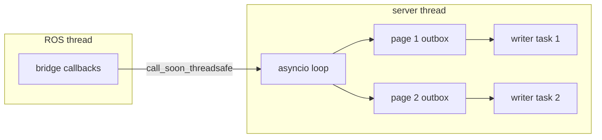

# web_server: one port for the page and its websocket

> **Untested as of this version.** The module and its tests were written on the robot's Pi, which has no `aiohttp`. They have not been run.

`web_server` serves the page's files and a single websocket, using `aiohttp`. It knows nothing about ROS or about what the messages mean. The bridge gives it two callbacks and pushes messages to it.

## Two threads, two concurrency models

`rclpy` runs callbacks on its executor's thread. `aiohttp` needs an asyncio event loop. Rather than mix them, the server runs **its own loop in its own thread**.



The only way across is `loop.call_soon_threadsafe`, the asyncio primitive for scheduling a plain function on a loop from another thread. `broadcast` and `send_camera` serialise on the calling thread, then hand the results to `enqueue` on the loop.

## Starting and failing loudly

`start()` launches the thread and **waits** for the loop to report back. If binding the port fails (port in use, bad host), the `OSError` is captured on the server thread and re-raised on the caller's as a `RuntimeError` naming host and port:

```python
if self.start_error is not None:
    self.thread.join()
    raise RuntimeError(
        f"web server failed on {self.config.host}:{self.config.port}"
    ) from self.start_error
```

Without this handshake, a bind failure would kill the background thread silently and the node would run with no page.

## One queue per page

Each websocket gets a `Page` with its own `asyncio.Queue` and a **writer task** that drains it. Broadcasting is then just `put_nowait` into every queue, which is synchronous on the loop.

This buys two things:

- **Ordering**: the snapshot from `on_connect()` is queued *before* the page is registered for broadcasts, so it always arrives first.
- **Isolation**: a slow page only backs up its own queue; the others keep receiving.

## The camera: count pages, not messages

The page sends one kind of message: `{"type": "camera", "is_on": bool}`. The server records the flag per page and calls `on_camera_change(is_wanted)` only when the **number of pages with the camera on** crosses zero:

```python
was_wanted = any(other.is_camera_on for other in self.pages)
page.is_camera_on = is_on
is_wanted = any(other.is_camera_on for other in self.pages)
if is_wanted != was_wanted:
    self.on_camera_change(is_wanted)
```

A page that **closes** with the camera on goes through the same path. So the bridge can subscribe to the camera topic exactly while someone is watching, which keeps the Pi's cost at zero otherwise. Camera JPEGs go as binary frames, only to pages that asked.

Anything else a page sends is **logged as a warning and ignored**, not acted on.

## Observations

- **Queues are unbounded.** A page that stops reading without closing would grow its queue until the heartbeat (10 s) drops it. A `maxsize` with drop-oldest would bound memory, especially for camera frames.
- **A bind failure leaves the runner un-cleaned** before the loop closes. Harmless when the process then exits, but worth a `cleanup()` if the server is ever restarted in-process.
- **Snapshot timing**: a delta computed just before a snapshot but scheduled after it can reach a new page twice. For trails and graphs that is a duplicate point, invisible on screen; for anything stateful it would matter.
- **`on_connect` and `on_camera_change` run on the server thread**. The bridge's lock and its subscription changes must be safe from there.
