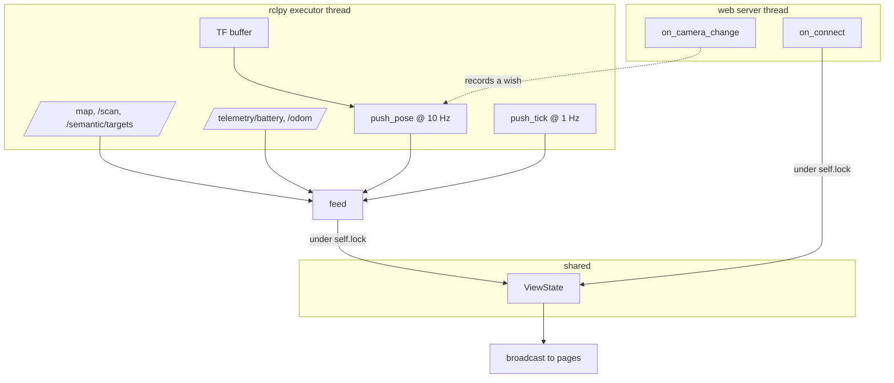

# bridge_node: the only place ROS and the page meet

Every other module in `dome_viz` is deliberately ignorant. `floor_plan` and `wall_fit` know about numpy grids; `view_state` and `run_history` know about dictionaries that happen to serialise as JSON; `web_server` knows about sockets. **None of them import `rclpy`.** `bridge_node` is where that ignorance is paid for: it is the single adapter that turns the robot's topics into `ViewState` calls, and `ViewState`'s messages into websocket traffic.

This is the *ports and adapters* shape, and the payoff is visible in the test suite: 63 of the project's 74 tests need no ROS graph at all.

## The shape of the thing



Two threads reach `ViewState`, and that is the central fact the module is built around.

## One lock, one funnel

`ViewState` is explicitly not thread-safe — its docstring says the bridge holds a lock. The temptation is to sprinkle `with self.lock:` through six callbacks. Instead there is one funnel:

```python
def feed(self, method, *view_args) -> None:
    """One `ViewState` call under the lock, and its messages to the pages."""
    with self.lock:
        messages = method(*view_args, self.now_s())
    if messages:
        self.server.broadcast(messages)
```

Three things are worth noticing:

- **The lock is held for the `ViewState` call only**, not the broadcast. `broadcast` just serialises and hands off via `call_soon_threadsafe`, so holding the lock across it would serialise the two threads for no reason.
- **`now_s()` is read inside the lock**, so the timestamps a `ViewState` sees are ordered the same way its calls are.
- **`method` is a bound method of `view`**, passed in rather than named by string. Each callback reads as `self.feed(self.view.on_map, occupancy_of(grid))` — the ROS-to-plain-data conversion sits in the call, and the locking discipline sits in one place.

The `if messages` guard does double duty as the module's rate limiting. `ViewState` already throttles the laser to ~5 Hz and thins graph series to a point every two seconds; when it has nothing new it returns an empty list, and nothing crosses to the browser. **No throttling code was added here**, because there was nothing left to throttle.

## Time, so replay works

```python
def now_s(self) -> float:
    """Node time, so `use_sim_time` carries through to bag replay."""
    return self.get_clock().now().nanoseconds * 1e-9
```

Reading the *node's* clock rather than `time.time()` is what makes `ros2 bag play --clock` work: with `use_sim_time` set, "now" is the bag's time. `ViewState`'s run ticker, lost-target timeouts and quiet-gap run detection are all expressed in these seconds, so they all follow replay for free.

## Pose is a TF question, not a topic

There is no pose topic. The robot's position is a TF lookup on a timer, and it takes **two** of them:

```python
robot_in_odom = self.lookup(ODOM_FRAME, ROBOT_FRAME, latest)
map_from_odom = self.lookup(MAP_FRAME, ODOM_FRAME, latest)
if robot_in_odom is None or map_from_odom is None:
    return
```

Why not simply ask for `map → base_footprint`, which is one call and gives the answer directly? Because `ViewState` keeps the **trail in the `odom` frame** and re-projects it through the current `map → odom` on every send. When slam_toolbox closes a loop, `map → odom` jumps, and the whole trail moves with the map instead of being left cutting through walls. The bridge must therefore hand over the two transforms separately — the decomposition is load-bearing, not incidental.

A failed lookup returns `None` and the push is skipped:

```python
except TransformException as error:
    self.get_logger().debug(f"no transform {parent} -> {child}: {error}")
    return None
```

This is the one place where "return `None` on a problem" is the right answer rather than a style violation: TF not yet having a transform is a **normal startup and replay condition**, not an error, and the alternative — inventing a pose — would draw the robot somewhere it has never been.

### The absent answer that isn't an exception

There is a second, nastier way for TF to have no real answer, and it does *not* raise. **A `tf2` buffer only discards old transforms as new ones are inserted.** When the publishers stop, whatever it last held simply stays, and a `Time()` lookup — "latest available" — goes on returning it with no staleness limit at all.

The first live run against the robot showed what that costs. The robot's stack went away entirely, and the bridge kept emitting a pose ten times a second, all identical, while reporting the page a green `"live"`:

```
state: "live"
ages_s: {map: 42.7, odom: 38.9, pose: 0.0, ...}
```

Note `pose: 0.0` against `map: 42.7`. **The pose timer was manufacturing its own liveness**: every other source's age means "a message arrived", but `pose` is driven by our own timer, so its age meant only "the timer ran". A motionless robot presented as live is indistinguishable from a robot that is merely parked — which is precisely the distinction the status line exists to draw.

The fix is to judge the transform by its own stamp:

```python
age_s = self.now_s() - stamp_s(transform.header.stamp)
if age_s > TF_STALE_S:
    return None
```

Two things make this the right place for it rather than patching the status logic:

- **It treats the data, not the symptom.** A dead publisher's final transform is not where the robot is; returning it is returning a bad value, which the project's own error rules forbid.
- **The status then fixes itself.** No pose message means `heard("pose")` is never called, so every source falls quiet and `ViewState`'s existing `QUIET_S` logic reaches `not_connected` unaided. No change to the pure modules at all.

Measured against a publisher that genuinely dies: the robot stops being drawn `TF_STALE_S` later, and the page says `not_connected` `TF_STALE_S + QUIET_S` later. `TF_STALE_S` is 2.0 s against slam_toolbox's configured 0.05 s publish period — a factor of forty, so it cannot reject a live transform.

A pleasing side effect: the check is meaningful at *both* call sites despite measuring subtly different things. For the pose it is the transform's true staleness; for the laser, where the lookup asks at the scan's own stamp and `tf2` returns that stamp back, it becomes "don't draw a scan older than two seconds" — which is also what you want.

The laser follows the same pattern but asks at the scan's *own* stamp, `Time.from_msg(scan.header.stamp)`, so rays are placed where the lidar was when it swept, not where the robot is now.

## The camera, and a thread you must not touch

The project's governing constraint is that the viewer must cost the Pi nothing when nobody is looking (`notes.md`, "Keep the Pi's load unchanged"). `dome_vision` only encodes images when something subscribes, so the bridge subscribes **only while a page has the panel open**.

The obvious implementation is to create and destroy the subscription inside `on_camera_change`. That callback, however, arrives on the *web server's* thread, and `rclpy`'s node is not safe to mutate from under its spinning executor. So the callback refuses to do the work:

```python
def on_camera_change(self, is_wanted: bool) -> None:
    """Also the server's thread: only record the wish, never subscribe."""
    with self.lock:
        self.is_camera_wanted = is_wanted
```

and the pose timer — which already runs on the executor at 10 Hz — reconciles it:

```python
if is_wanted and self.camera_subscription is None:
    self.camera_subscription = self.create_subscription(...)
elif not is_wanted and self.camera_subscription is not None:
    self.destroy_subscription(self.camera_subscription)
    self.camera_subscription = None
```

This is the *deferred reconciliation* pattern: a foreign thread writes desired state, the owning thread converges actual state onto it. The cost is up to 100 ms of latency on a panel toggle, which no user can perceive. The benefit is that no framework object is ever mutated from the wrong thread.

The test encodes exactly this, including the part that would be invisible otherwise:

```python
node.on_camera_change(True)
assert node.camera_subscription is None, "must wait for our own thread"
node.reconcile_camera()
assert node.camera_subscription is not None
```

## Conversions as free functions

The ROS-message-to-plain-data translations are module-level functions, not methods: `occupancy_of`, `targets_of`, `scan_of`, `pose2d_of`, `yaw_of`, `stamp_s`. They need no node, so they take none, and they can be read and reasoned about without the class.

`yaw_of` is the only one with real content — the standard quaternion-to-yaw reduction, which collapses to two terms once you only want rotation about *z*:

```python
along = 2.0 * (quaternion.w * quaternion.z + quaternion.x * quaternion.y)
across = 1.0 - 2.0 * (quaternion.y**2 + quaternion.z**2)
return math.atan2(along, across)
```

Using `atan2` rather than `asin` keeps all four quadrants, so a robot facing backwards reads as ±π rather than wrapping to zero.

## Observations

- **`class_profile_path` defaults to empty**, which makes targets display a raw label and a two-letter prefix (`CA7`) instead of `soda can · CN1`. `dome_semantic` does not install its `class_profiles.yaml`; the only installed copy belongs to `dome_vision_ros`. This wants settling at TF01.9, either as a launch default or a vendored copy.
- **The 10 Hz pose timer does two jobs** — pose pushes and camera reconciliation. It works and it avoids a second timer, but the coupling is incidental; a reader could reasonably expect `reconcile_camera` to live on its own timer.
- **Topic names are constants, not parameters.** Fine for one robot; the moment a second namespace appears they should become declared parameters.
- **A silent source is handled, but by `ViewState`, not here.** `/telemetry/battery` is currently disabled on the robot and simply never arrives. Nothing in the bridge notices or needs to, because `is_connected` is an `any` over source ages and the run-gap check uses the most recent message from *any* source.
- **Under `use_sim_time` nothing can ever go stale**, because a stopped bag stops `/clock` and the node's clock freezes with it, so `TF_STALE_S` is never exceeded. That is the right behaviour for a paused replay, but it does mean the staleness guard protects live running only.
