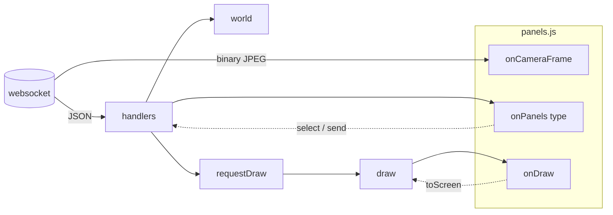
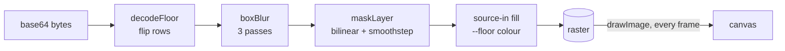

# app.js: the live map, from websocket to canvas

`bridge_node` ends its chapter by putting JSON on a websocket. This file picks it up in the browser. It turns those messages into a floor plan you can pan and zoom, with the robot drawn to scale, its trail, the laser and a grid.

It is **plain JavaScript and one `<canvas>`, with no library and no build step** (`notes.md`, "Web stack"). The page must work on a LAN with no internet, so there is nothing to fetch from a CDN and nothing to vendor. The whole file is one IIFE, so none of its names leak into the page. The single exception is the seam described below.

## Two files, one seam

The page is split in two:

- **`app.js` owns the map**: the canvas, the view transform, the websocket and the map's own buttons.
- **`panels.js` owns everything else**: the object markers, the objects list, the camera, the status line and the run graphs (chapter 08).

They talk through one object on `window`:

```javascript
const api = {
  world, state,
  onPanels: () => {},
  onDraw: () => {},
  onCameraFrame: () => {},
  send: (message) => socket?.readyState === WebSocket.OPEN
    && socket.send(JSON.stringify(message)),
};
window.domeViz = api;
```

This is a *hook object*. `app.js` installs no-op hooks, and `panels.js`, which loads second, replaces them. Data flows in one direction: `app.js` mutates `world`, then calls the hooks, and `panels.js` reads `world` without writing it.

The only calls that go the other way are `select`, `send`, `toScreen` and `requestDraw`, added to `api` later in the file.



## Two kinds of state

The file keeps two plain objects, and the split between them is deliberate:

- **`world`** is what the robot has said: `plan`, `robot`, `trail`, `laser`, `targets`, `series` and `status`. Only the message handlers write it.
- **`state`** is what the viewer is doing: `scale` (pixels per metre), the view centre `cx, cy` in map metres, `follow`, `showLaser`, `selected`, and two connection flags.

Keeping them apart means a new message can never reset the user's zoom, and panning can never corrupt the robot's data.

## Messages: a dispatch table

Each JSON message has a `type`, and `handlers` maps that type to a function. An unknown type is ignored, so a newer bridge can add a type without breaking an older page.

```javascript
socket.addEventListener("message", (event) => {
  if (typeof event.data !== "string") {
    api.onCameraFrame(event.data);
    return;
  }
  const message = JSON.parse(event.data);
  const handler = handlers[message.type];
  if (!handler) return;
  handler(message);
  api.onPanels(message.type);
  requestDraw();
});
```

**Binary frames are always camera JPEGs.** A text/binary split costs nothing, and it saves base64-encoding a few hundred kilobytes of image per frame.

### Snapshots and deltas

`trail` and `run` messages carry an `is_full` flag. This mirrors `run_history`'s design (chapter 03):

- A full message, sent on connect or at a new run, **replaces** the data.
- A delta **appends** to it.

Either way the result is trimmed to the server's `max_points`, so the page cannot grow without bound over a long run.

```javascript
trail(message) {
  world.trailMax = message.max_points;
  world.trail = message.is_full ? message.points : world.trail.concat(message.points);
  if (world.trail.length > world.trailMax) {
    world.trail = world.trail.slice(world.trail.length - world.trailMax);
  }
},
```

### Reconnecting

When the socket closes, `connect` runs again a second later, forever. **The page needs no reload when the bridge restarts.** The server sends a snapshot to every new connection (`ViewState.snapshot`), so a reconnected page rebuilds its whole `world` from that.

## The view transform

Every drawing routine goes through two functions:

```javascript
const viewRot = () => (state.isSquared && world.plan ? -world.plan.angle_rad : 0);
const toScreen = (x, y) => {
  const rot = viewRot(), c = Math.cos(rot), s = Math.sin(rot);
  const dx = x - state.cx, dy = y - state.cy;
  return [
    stage.clientWidth / 2 + (dx * c - dy * s) * state.scale,
    stage.clientHeight / 2 - (dx * s + dy * c) * state.scale,
  ];
};
```

`toWorld` is its exact inverse; a numeric round trip at several angles comes back within 10⁻¹⁵. Four choices are built into it:

- **The view centre, not a corner, is the anchor.** Resizing the window keeps what you were looking at in the middle, and the Square up turn pivots there too, so toggling it leaves the same spot in the middle.
- **The minus on `y`** is the one place the coordinate systems meet. Map y points up, as ROS has it; canvas y points down. Nothing else in the file needs to know.
- **One rotation, `viewRot`, squares the room up** (F02). It turns the view by minus the room's wall angle, so the walls run across and down the screen. Map coordinates never change: every number on screen stays in the `map` frame, and the grid turns with the map rather than staying aligned to the window.
- **Everything else asks the transform** rather than doing its own arithmetic, which is what lets one rotation reach the whole page. The pieces that had to change are listed below.

### Zooming toward the pointer

The wheel zooms toward whatever is under the cursor. `zoomAt` records the world point under the pointer, changes the scale, and then solves for the centre that puts that point back under the pointer:

```javascript
const [wx, wy] = toWorld(sx, sy);
state.scale = clampScale(state.scale * factor);
const [nx, ny] = toWorld(sx, sy);
state.cx += wx - nx; state.cy += wy - ny;
```

Rather than rearranging `toScreen` by hand, it asks `toWorld` again at the new scale and shifts the centre by the difference. That stays exact whatever the rotation. `Math.exp(-deltaY * .0015)` makes zoom *multiplicative*: equal wheel movements give equal ratios, so zooming in and back out returns you to the same scale. `clampScale` limits it to 15–600 px/m.

**When Follow is on, the centre is not moved.** The robot owns the centre then, and zoom happens around it.

### Pan, pinch and Follow

Pointer events cover the mouse, touch and pen in one code path. `pointers` maps each active pointer to its last position:

- **One pointer pans.** The centre moves by the map distance between the previous and current pointer positions, both found with `toWorld`, so the map tracks the finger exactly even when the view is turned.
- **Two pointers pinch.** The scale is the starting scale times the ratio of the current finger spread to the starting spread.

**Any drag turns Follow off.** Otherwise the next pose would snap the view straight back, and the drag would seem to have done nothing. That was step 4 of TF01.7's checklist.

**A drag must not also count as a click.** The browser ends every drag with a `click` on the stage, and the stage's click handler deselects. So a pan sets `hasDragged`, the next `pointerdown` clears it, and the click handler returns early while it is set. Without it, panning around a selected object threw the selection away.

### Fit

`fit` frames the *known* cells, not the whole grid. The SLAM grid is usually far larger than what has been explored, so framing the grid would leave the room as a speck. It scans every cell, takes the bounding box of the free ones, and leaves 80 px of horizontal and 120 px of vertical margin for the controls.

**The box is taken in the turned frame**, as the screen will show it: each cell is rotated before it is measured, and the box's centre is rotated back into `map` metres. A box measured in `map` axes would frame a tilted room badly, off-centre or clipped.

It runs by itself only on the **first** floor plan. Later maps leave the view alone, because the user may have moved it.

## The floor raster: the one expensive thing

The free space comes as one byte per cell, at 5 cm per cell. Drawing it as squares would look like a spreadsheet. Instead the page builds a **smooth, anti-aliased shape** once per map into an offscreen canvas, then just scales that image on every repaint.



### The row flip

```javascript
// The message is in OccupancyGrid order, row 0 at the LOWEST y.
field[(h - 1 - row) * w + col] = bytes[row * w + col] ? 1 : 0;
```

`nav_msgs/OccupancyGrid` stores row 0 at the bottom. A canvas's row 0 is the top. The flip happens **once, at decode**, so every later routine (`fit` included) can treat field row 0 as the top of the picture. Getting this wrong mirrors the map vertically, which is why it was step 1 of the checklist.

### Blur, then threshold

This is a classic way to *round corners and close pinholes* in a binary mask:

1. **`boxBlur`** averages each cell with its neighbours, first horizontally and then vertically. Three passes of a box blur come close to a Gaussian blur (the central limit theorem at work), and each pass is linear in the number of cells.
2. **`maskLayer`** resamples the blurred field at `px` pixels per cell, with *bilinear interpolation* between the four nearest cells.
3. It then applies a **soft threshold**: values below `threshold - edge` are transparent, values above `threshold + edge` are opaque, and the band between uses *smoothstep*, `t² (3 − 2t)`, which gives an anti-aliased edge with no visible ramp.

A single unknown cell inside free space blurs to roughly 0.6, still above the 0.42 threshold, so it disappears. A real doorway is several cells wide and survives.

The alpha mask is then coloured in one step with `globalCompositeOperation = "source-in"`, which paints the floor colour only where the mask is opaque. Separating the mask from the colour is what makes a theme change cheap.

### Bounding the cost

```javascript
px = Math.max(PX_MIN, Math.min(PX_MAX, Math.floor(RASTER_SIDE_MAX / Math.max(w, h))));
```

`maskLayer` costs about `w·h·px²` operations. At 8 px per cell, a 600-cell map would make a 4800 px raster, which is a visible stall in the browser. **`px` is therefore chosen per map so the longer side never exceeds 2048 px**, dropping to as little as 2 px per cell for very large maps. The image is scaled to the zoom with `drawImage` anyway, so a smaller raster only costs sharpness at extreme zoom.

### When it is rebuilt

```javascript
if (world.plan && (!raster || rasterTheme !== themeKey())) buildRaster();
```

Two triggers only: a new `floor_plan` (the handler sets `raster = null`), or a change of theme. `themeKey` concatenates the current `--floor` and `--wall` colours. **Comparing the colours themselves**, rather than listening for a "theme changed" event, also catches a change made in the browser's dev tools, and avoids the bug in checklist step 8, where the floor kept the old theme's colour.

## Drawing: coalesced, back to front

```javascript
function requestDraw() {
  if (isDrawPending) return;
  isDrawPending = true;
  requestAnimationFrame(() => { isDrawPending = false; draw(); });
}
```

Messages arrive in bursts: a pose, a laser scan and a status can land within milliseconds of each other. **Every handler asks for a draw, but only one happens per animation frame.** This is the *dirty flag* pattern: a burst costs one repaint, and nothing is drawn faster than the display refreshes.

`draw` itself follows the *painter's algorithm*, back to front:

1. Size the canvas for `devicePixelRatio`, so lines stay sharp on a Retina screen, then set the transform so the code can work in CSS pixels.
2. Draw the floor raster.
3. Draw the grid, walls and clutter, the origin, the laser, the trail and the robot.
4. Draw the scale bar, which is a DOM element and not canvas.
5. Call `api.onDraw()`, so panels.js can move its markers to match.

### Things that adapt to the zoom

Several pieces choose a "nice" value from a fixed list, based on the current scale:

- **Grid step**: the first of 0.5, 1, 2, 5 or 10 m that makes cells at least 46 px apart.
- **Scale bar**: the first of 25 cm up to 10 m that is at least 66 px wide. Its width and label are always set together, which was checklist step 5.
- **Line widths** take a floor in pixels and otherwise follow the scale, so walls stay visible zoomed out but don't turn into slabs zoomed in. Walls are `max(1 px, 2 cm)` in light steel blue (`--wall`), set by eye after the first, near-black 7 cm version read as too heavy.

### What the rotation touched

Most drawing goes through `toScreen` and turns for free. Five things had their own idea of "up" and needed the turn added:

- **The floor raster** is an axis-aligned image, so it is drawn under `ctx.rotate(-viewRot())` about its top-left corner.
- **The grid** draws map-x and map-y lines across the bounds of all four screen corners, and labels each where it crosses the top or left edge, found by walking along that edge in map coordinates.
- **The origin arrows** point along the turned x and y axes.
- **The robot** rotates by its yaw plus the view's turn.
- **`bringIntoView`** finds the new centre with `toWorld`, so the gentle pan heads the right way.

Clutter and wall-cell squares are left screen-aligned: at a few pixels across, turning them would cost a `ctx.rotate` per square for no visible gain.

**The Square up button** sets `state.isSquared`, and keeps the choice in `localStorage` so it survives a reload. It is a per-viewer preference, not robot state, so browser storage is the right home; every read and write is wrapped in try/catch, because storage can be blocked, and the view works without it.

Lines are drawn at `Math.round(x) + .5`. A 1 px line centred on a pixel boundary spreads over two pixels at half strength, so the half-pixel offset is what keeps grid lines crisp.

### The robot, to scale

`drawRobot` draws DOME seen from above, using measurements from dome2's URDF: the 0.30 m plate, the drive wheels, the caster, the lidar and the camera bar, plus a chevron for the heading.

- `ctx.translate` and `ctx.rotate(-robot.yaw)` put the drawing in the robot's own frame. The yaw is negated because canvas angles turn clockwise.
- **`s = Math.max(state.scale, 30 / 0.30)`** keeps it to scale when zoomed in, but never smaller than about 30 px, so it never shrinks to a dot.
- **When offline**, the accent colour turns grey and the glow is dropped, so a stale robot is obviously stale.

### The trail and laser

- **The trail** fades from 12 % opacity at its oldest point to 57 % at its newest, which shows the direction of travel without arrows.
- **The laser** draws all its rays as one path at 22 % opacity, then the hit points at 60 %. The rays were made a little darker during TF01.7. It is not drawn when offline, because an old scan would claim walls the robot can no longer see.

## Selection and the gentle pan

`api.select` toggles the selection: clicking the same object again deselects it. Clicking empty map deselects too. `bringIntoView` follows `layout.md`'s rule: **never zoom, and pan only if the object is within 56 px of the edge or off the screen**, and then only far enough to bring it inside that margin.

The pan runs for 350 ms with a *cubic ease-out*, `1 − (1 − t)³`, which starts fast and settles gently. It skips the animation entirely when the user has asked for reduced motion. It calls `draw` directly rather than `requestDraw`, because it is already running inside an animation frame.

## Observations

1. **`css()` is called dozens of times per frame.** Each call runs `getComputedStyle` and reads a custom property; `drawRobot` alone makes five. Caching the colours in an object, refreshed when `themeKey` changes, would remove that from every frame at no cost in clarity.
2. **The trail is stroked one segment at a time**, up to 2000 `stroke()` calls per repaint, because every segment has its own opacity. Grouping segments into about ten opacity bands, one path per band, would look the same and be far cheaper on long runs.
3. **`fit` scans the whole grid** to find the known cells. That's fine once per first map, but the bridge already holds the same grid in numpy, where the bounds are a one-line `nonzero()`; sending them in `floor_plan` would make `fit` trivial.
4. **The file is 580 lines and holds four concerns**: the raster, the transform, drawing, and input. The app.js split chore, no longer blocked now that F02 has landed, would likely give the raster pipeline its own file first, since it is the self-contained part.
