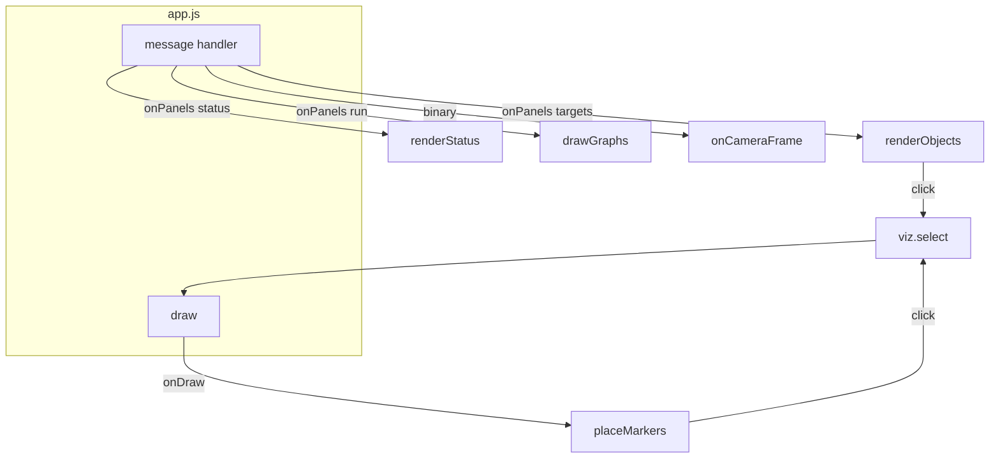

# panels.js: everything on the page that isn't the map

`app.js` draws the map. This file draws everything around it and on top of it:

- **object markers**, the pins and chips over the map
- the **objects list** and the detail block for the selected object
- the **camera** panel and its on/off switch
- the **status line**, with its per-source details and the offline banner
- the four **"this run" graphs**

It holds no state of its own about the robot. Everything comes from `window.domeViz` (chapter 07): it reads `world` and `state`, and installs three hooks.

```javascript
viz.onPanels = (what) => {
  if (what === "status" || what === undefined) renderStatus();
  if (what === "targets" || what === undefined) renderObjects();
  if (what === "run" || what === undefined) drawGraphs();
};
viz.onDraw = placeMarkers;
```

**`what` is the type of the message that just arrived.** The bridge pushes the robot's pose at 10 Hz. Without this filter, every pose would rebuild the objects list and redraw four graphs. `undefined` means "everything", which is used when the socket opens or closes.



## Words before numbers

The page is meant to be friendly (spec: "a friendly, read-only view"), so ages are shown as words. There are two helpers, and the difference between them is about grammar:

```javascript
const ago = (seconds) =>
  seconds == null ? "never"
    : seconds <= 5 ? "live"
    : seconds < 60 ? `${Math.round(seconds)} s ago`
    : `${Math.round(seconds / 60)} min ago`;
```

- **`ago`** stands alone, in a per-source row or an object's list row, where *live* is the useful word.
- **`since`** goes inside a sentence that already says "updated" ("map updated just now"), where *live* would read wrongly.

The 5 s cut-off in `ago` is the same as `QUIET_S` and `LOST_TIMEOUT_S` in `view_state`. "Live" on the page and "connected" in the bridge therefore mean the same thing.

## Object markers

### Reused, not rebuilt

```javascript
// One element per target, reused between renders: rebuilding them on every
// repaint would throw away focus and make clicking unreliable.
```

`placeMarkers` runs after **every** map repaint, including each frame of a pan. If it replaced the buttons each time, a mouse-down on one button followed by a mouse-up on its replacement would never count as a click. So `markerEls` keeps one `<button>` per target ID:

- a new ID gets a new button
- an ID that has disappeared has its button removed
- everything else is moved and updated

The markers are **DOM buttons over the canvas, not canvas drawings**. They get keyboard focus, `aria-label`s and hover styling for free, and a click on one can call `stopPropagation`, so the map's own deselect-on-click never sees it.

They are **shown whenever the map canvas is**: once a floor plan exists, or before that once the robot is drawn. The gate is `world.plan || world.robot`, the same one app.js uses. An earlier gate on the floor plan alone meant an object could be listed "in view" with no marker, before SLAM was up.

### Decluttering: a greedy placement

When chips would overlap, only the pin of the less interesting one is shown. This is a *greedy* approach to label placement. The general problem is NP-hard; the greedy version is cheap and good enough here:

1. **Rank** every target: selected first, then in view, then by number of sightings. The weights (10⁹, 10⁶, the count) make this one sortable number with no ties between the tiers.
2. **Place in rank order.** Each chip's box is tested against the boxes already placed.
3. **On overlap**, mark the chip `data-crowded`, and CSS hides the chip while keeping the pin.

```javascript
const isCrowded = overlaps && !isSelected;
element.dataset.crowded = isCrowded;
if (!isCrowded) placed.push(box);   // a hidden chip blocks nothing
```

Two details matter. **The selected object's chip is never hidden**, because it is the one the user asked about. **A hidden chip is not added to `placed`**, so it cannot knock out a chip ranked below it. Without that rule, one crowded corner could hide a whole chain of chips.

The test is pairwise, O(n²), which is fine for the tens of objects a run finds.

### Lost but not hidden

`data-lost` fades a marker and gives it a dashed outline. **Lost objects are never removed** (layout.md): "it was here a minute ago" is exactly what the user wants to know.

## The objects list

`renderObjects` splits the targets into two groups:

- **In view now**, most-seen first
- **Seen earlier**, most recent first

The detail block for the selected object sits above both. Rows show the class icon and colour, the short ID (`CN3`), the name, and `ago`. A click calls the same `viz.select` as a marker, so the list, the markers and the map's pan all stay in step.

### Colour and icon by detector label

```javascript
const CLASS_VAR = { can: "--can", cup: "--cup" };
const ICON = { can: "#ic-can", cup: "#ic-cup" };
```

These are keyed by the **raw detector label** (`can`), which is why `view_state` puts `label` in each target alongside the readable `name` ("soda can"). Unknown classes fall back to a muted colour and a generic icon, rather than an error.

### Escaping

Every name and ID passes through `escaped` before being put into HTML. The names come from a YAML file and the IDs from the robot, and neither is under the page's control. The regex uses `\x22` for the double-quote character so the pattern contains no literal `"` that could end an attribute early.

## The camera, and the Pi's load

```javascript
cameraToggle.addEventListener("change", () => {
  viz.send({ type: "camera", is_on: cameraToggle.checked });
```

**The toggle is the only thing that makes the robot send video.** The bridge subscribes to the image topic only while some page has it on, and `dome_vision` only encodes when someone subscribes (notes.md, "Keep the Pi's load unchanged"). The text shown when it's off says so in plain words.

Frames arrive as binary JPEG. Each one becomes a `Blob`, then an *object URL*, then the ``'s `src`. **The previous URL is revoked as soon as the next is set**, or a 15 fps stream would leak a few hundred kilobytes per frame for as long as the page stays open.

## The status line

The line reads one of three states from `ViewState`, plus a short sub-clause:

| state | wording | sub-clause |
| --- | --- | --- |
| `live` | Live | map updated *since(map)* |
| `waiting_for_map` | Waiting for the map | robot connected |
| `not_connected` | Robot not connected | last heard *since(newest age)* |

There is a fourth case before any of these: **the socket to the viewer itself is closed.** That says "Not connected to the viewer", which is a different fault from the robot being gone, so it has different wording.

Clicking the line opens the per-source details (map, robot, objects, laser, camera, each with `ago`). A click anywhere else closes it. When the robot is offline but a map exists, a **banner** says the page is showing the last map and how old it is.

## The run graphs

Four small time-series charts: battery percent, power draw, speed, and objects found. `GRAPHS` describes each one in data: its key, a format, an optional fixed range, and whether it is a step chart. One `drawGraph` then handles all four.

### Nice axis steps

```javascript
function niceStep(span, count) {
  const raw = span / count || 1;
  const magnitude = 10 ** Math.floor(Math.log10(raw));
  const scaled = raw / magnitude;
  const factor = scaled <= 1 ? 1 : scaled <= 2 ? 2 : scaled <= 2.5 ? 2.5 : scaled <= 5 ? 5 : 10;
  return factor * magnitude;
}
```

This is the classic *nice numbers* algorithm used by most charting libraries. It splits the rough step into a power of ten and a factor between 1 and 10, then rounds the factor up to 1, 2, 2.5, 5 or 10. Ticks land on values a person would choose: 0, 0.5, 1.0, not 0, 0.47, 0.94.

An open-ended range rounds its top up to a whole step, plus one more if the peak would touch it, so the line never runs into the top edge. The time axis picks from a fixed ladder, 15 s to an hour, so that it shows at most five ticks.

### Steps for counts

"Objects found" is drawn as a **step chart**: horizontal, then vertical. A count jumps from 3 to 4; it never passes through 3.5, and a sloped line would suggest that it did.

### The x axis is the run, not the data

```javascript
const runSeconds = Math.max(world.status?.run_s ?? 0, points.at(-1)[0], 1);
```

All four graphs share the run's elapsed time as their x range. **A source that stopped publishing shows a line that ends early**, rather than being stretched to fill the width. That's honest about when the data stopped, and it keeps the four graphs aligned so a reader can compare them at a given moment.

### Hover

The tooltip finds the last point at or before the pointer, with a linear scan. It draws a vertical guide and a dot, and adds a `.tip` element. Each redraw first removes the old tip, so there is never more than one.

## Observations

1. **The objects list is rebuilt from `innerHTML` every second**, because `tick` sends `targets` at 1 Hz. That discards keyboard focus on the list, the same problem the markers avoid by reusing elements. Reusing rows by ID would fix it, as would skipping the render when nothing visible has changed.
2. **`placeMarkers` writes `innerHTML` and then reads `offsetWidth` for each marker, on every frame.** Each read forces a layout, so a pan with many objects does n layouts per frame (*layout thrashing*). Doing all the writes first and then all the reads, or caching each chip's width until its label changes, would keep pans smooth.
3. **The class colours and icons are hard-coded for `can` and `cup`**, while the class profiles already come from `dome_vision_ros`'s YAML. A new class will get the generic icon until someone edits this file. Sending a colour or icon key from the profile would remove that dependency.
